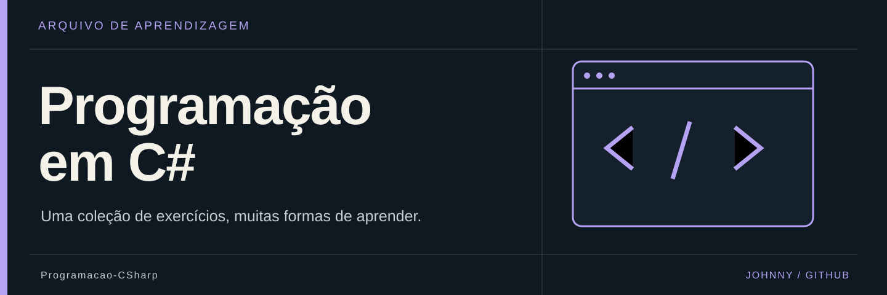

  

# 💻 Programação em C#

**Uma coleção de exercícios, muitas formas de aprender.**

Soluções de programação organizadas por semestre, com exercícios Windows Forms e uma área dedicada a métodos. Cada solução conserva o seu próprio projeto; este repositório é uma coleção, não um executável único.

📚 Arquivo académico · 🧭 Índice do conteúdo preservado

## 🗂️ Por onde começar

| Abrir | O que encontras |
| --- | --- |
| [Primeiro semestre](1%C2%BASemestre) | Exercícios e soluções iniciais. |
| [Segundo semestre](2%C2%BASemestre) | Continuação do percurso. |
| [Métodos](M%C3%A9todos) | Exercícios dedicados a métodos. |

## 🔎 Explorar o arquivo

Descarrega o projeto completo do exercício e abre o seu `.sln` no Visual Studio. Nos exercícios com interface, a lógica costuma estar em `Form1.cs` e a apresentação nos ficheiros associados ao formulário. Confirma o alvo no `.csproj`: o exemplo consultado usa Windows Forms e .NET Framework 4.6.1. Não basta copiar apenas o ficheiro do formulário.

## 📝 Sobre esta coleção

Este README organiza os ficheiros existentes; não certifica a execução dos exercícios em ambientes atuais. Enunciados, materiais de apoio, imagens e bibliotecas conservam a autoria dos respetivos titulares. A capa é uma ilustração editorial, não uma captura dos trabalhos.
